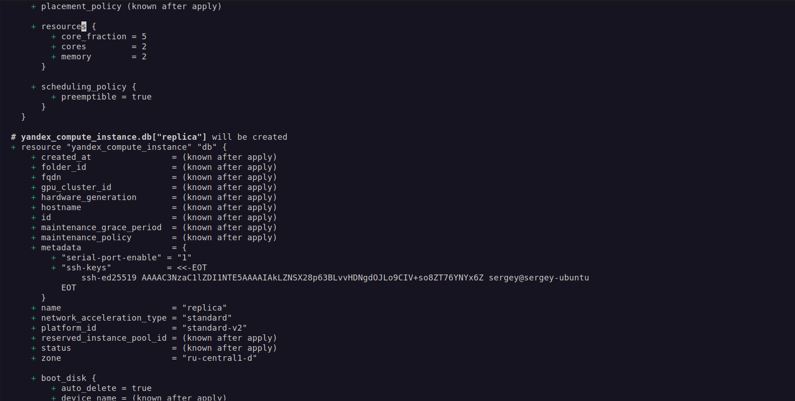
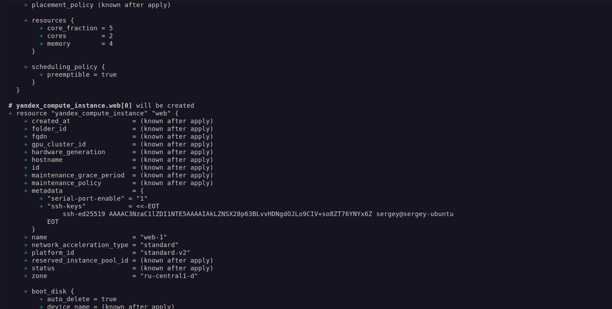
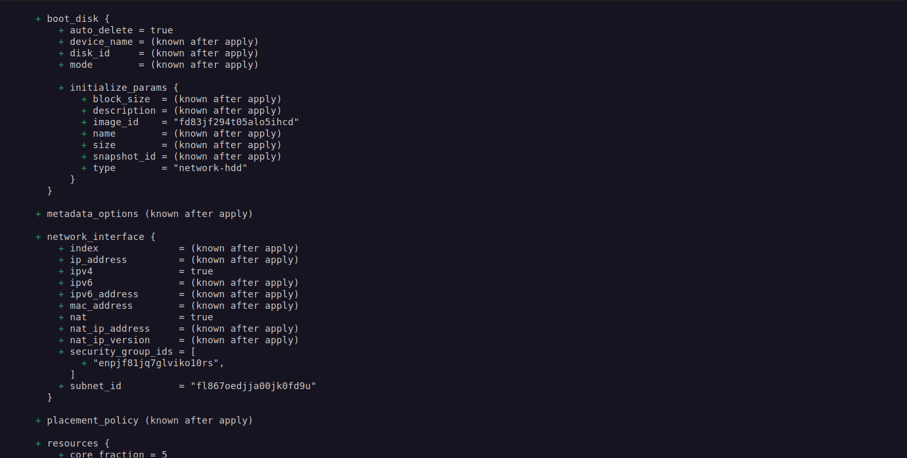
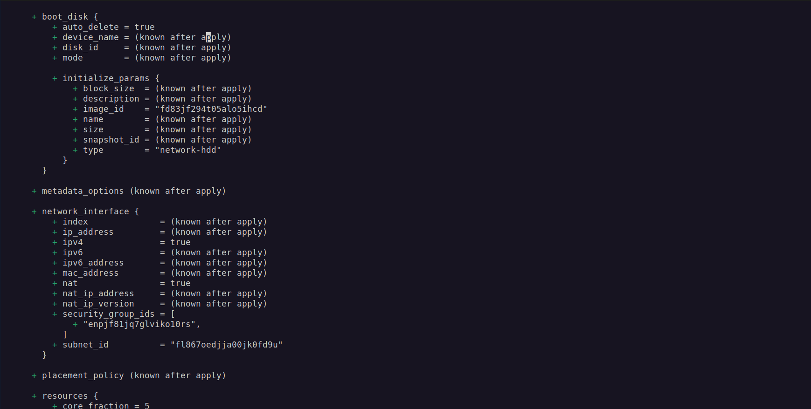
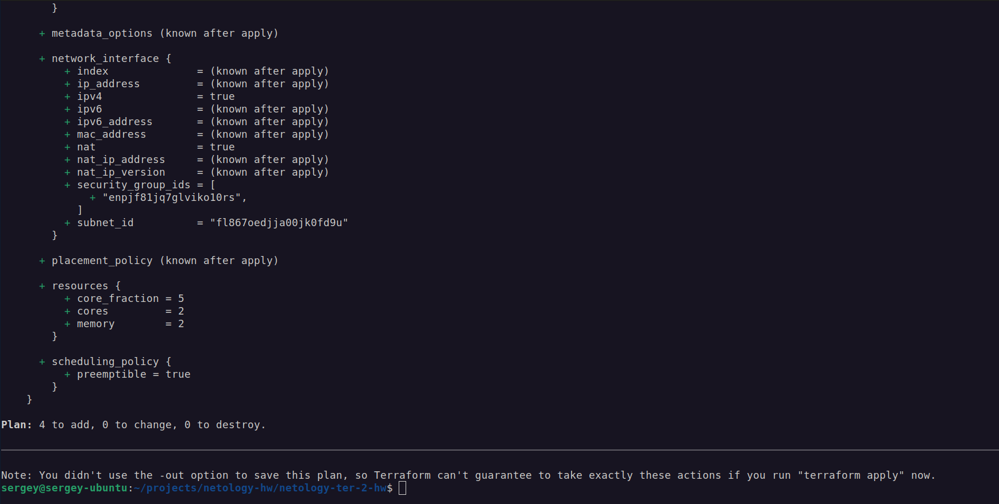
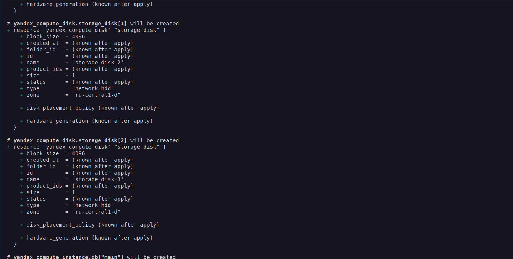

# Домашнее задание к занятию «Управляющие конструкции в коде Terraform»

---

## Задание 1. Изучение проекта и группа безопасности

### Изучение проекта

В проекте:
- [`main.tf`](main.tf) — VPC-сеть `develop` и подсеть `10.0.1.0/24`
- [`security.tf`](security.tf) — группа безопасности `example_dynamic` с **динамическими блоками** `ingress` и `egress`, управляемыми переменными `security_group_ingress` и `security_group_egress`
- [`providers.tf`](providers.tf) — провайдер Yandex Cloud, авторизация через **сервисный аккаунт** (`service_account_key_file`)
- [`variables.tf`](variables.tf) — переменные (cloud_id, folder_id, зона, CIDR, имя VPC)

Авторизация переведена с OAuth-токена на сервисный аккаунт — это рекомендованный и более безопасный способ, чем `token = var.token` из исходного кода.

### Инициализация


### Применение

План создания 3 ресурсов:
- `yandex_vpc_network.develop`
- `yandex_vpc_subnet.develop` (10.0.1.0/24, ru-central1-a)
- `yandex_vpc_security_group.example` (3 ingress-правила + 1 egress)


```txt
Apply complete! Resources: 3 added, 0 changed, 0 destroyed.
```

### Группа безопасности в ЛК

Группа `example_dynamic` создана с тремя входящими правилами:
- TCP 22 — SSH
- TCP 80 — HTTP
- TCP 443 — HTTPS


---

## Задание 2. `count`, `for_each` и зависимости между ресурсами

### Файл `count-vm.tf` — две web-ВМ через `count`

Созданы две одинаковые ВМ с именами `web-1` и `web-2` (не `web-0` и `web-1`) через мета-аргумент `count`:

```hcl
resource "yandex_compute_instance" "web" {
  count = 2

  name        = "web-${count.index + 1}"
  platform_id = "standard-v2"
  zone        = var.default_zone

  resources {
    cores         = 2
    memory        = 2
    core_fraction = 5
  }

  boot_disk {
    initialize_params {
      image_id = data.yandex_compute_image.ubuntu.image_id
    }
  }

  scheduling_policy {
    preemptible = true
  }

  network_interface {
    subnet_id          = yandex_vpc_subnet.develop.id
    security_group_ids = [yandex_vpc_security_group.example.id]
    nat                = true
  }

  metadata = {
    serial-port-enable = 1
    ssh-keys           = local.ssh_key
  }

  depends_on = [yandex_compute_instance.db]
}
```

**Ключевые моменты:**
- `count = 2` создаёт два экземпляра ресурса.
- `count.index + 1` сдвигает нумерацию с 0 на 1, чтобы имена были `web-1`, `web-2` (а не `web-0`, `web-1`).
- `security_group_ids = [yandex_vpc_security_group.example.id]` — привязка группы безопасности `example_dynamic` из задания 1.
- `depends_on = [yandex_compute_instance.db]` — web-ВМ создаются **после** db-ВМ (пункт 3 задания).

### Файл `for_each-vm.tf` — main и replica через `for_each`

Созданы две db-ВМ с разными параметрами через `for_each`:

```hcl
resource "yandex_compute_instance" "db" {
  for_each = { for vm in var.each_vm : vm.vm_name => vm }

  name        = each.value.vm_name
  platform_id = "standard-v2"
  zone        = var.default_zone

  resources {
    cores         = each.value.cpu
    memory        = each.value.ram
    core_fraction = 5
  }

  boot_disk {
    initialize_params {
      image_id = data.yandex_compute_image.ubuntu.image_id
      size     = each.value.disk_volume
    }
  }

  scheduling_policy {
    preemptible = true
  }

  network_interface {
    subnet_id          = yandex_vpc_subnet.develop.id
    security_group_ids = [yandex_vpc_security_group.example.id]
    nat                = true
  }

  metadata = {
    serial-port-enable = 1
    ssh-keys           = local.ssh_key
  }
}
```

**Ключевые моменты:**
- `for_each` не принимает список напрямую — нужен map или set. Конструкция `{ for vm in var.each_vm : vm.vm_name => vm }` преобразует список в map, где ключом становится `vm_name` (`main`, `replica`).
- `each.value.cpu`, `each.value.ram`, `each.value.disk_volume` — доступ к полям объекта.
- Параметры разные: `main` — CPU=2, RAM=2, диск=10; `replica` — CPU=2, RAM=4, диск=20.

### Переменная `each_vm` в `variables.tf`

```hcl
variable "each_vm" {
  type = list(object({
    vm_name     = string
    cpu         = number
    ram         = number
    disk_volume = number
  }))
  default = [
    {
      vm_name     = "main"
      cpu         = 2
      ram         = 2
      disk_volume = 10
    },
    {
      vm_name     = "replica"
      cpu         = 2
      ram         = 4
      disk_volume = 20
    }
  ]
  description = "List of VMs for for_each loop"
}
```

### SSH-ключ через `file()` в local-переменной

В [`locals.tf`](locals.tf) объявлена local-переменная, которая читает публичный ключ с диска:

```hcl
locals {
  ssh_key = file(pathexpand("~/.ssh/id_ed25519.pub"))
}
```

**Пояснение:**
- `file()` читает содержимое файла.
- `pathexpand()` раскрывает `~` в домашний каталог (Terraform не раскрывает тильду сам, в отличие от bash).

В задании указан `~/.ssh/id_rsa.pub`, но у меня используется ключ `id_ed25519.pub` — более современный алгоритм (ed25519 vs RSA). Функционально они равнозначны для SSH-аутентификации.

Ключ используется в блоке `metadata` обеих ВМ:

```hcl
metadata = {
  serial-port-enable = 1
  ssh-keys           = local.ssh_key
}
```

### План создания 4 ВМ

`terraform plan` показывает создание 4 ресурсов:

- `yandex_compute_instance.db["main"]` — CPU=2, RAM=2, диск=10
- `yandex_compute_instance.db["replica"]` — CPU=2, RAM=4, диск=20
- `yandex_compute_instance.web[0]` → `web-1` — CPU=2, RAM=2
- `yandex_compute_instance.web[1]` → `web-2` — CPU=2, RAM=2










Ключевые строки из плана:

```txt
Plan: 4 to add, 0 to change, 0 to destroy.
```

Все ВМ получают `security_group_ids = ["enpjf81jq7glviko10rs"]` — группу `example_dynamic` из задания 1. В блоке `metadata` — публичный SSH-ключ из `local.ssh_key`.

### Проверка списка ВМ

```bash
yc compute instance list
```

```txt
+----------------------+---------+---------------+---------+----------------+-------------+
|          ID          |  NAME   |    ZONE ID    | STATUS  |  EXTERNAL IP   | INTERNAL IP |
+----------------------+---------+---------------+---------+----------------+-------------+
| fhm3p4q5r6s7t8u9v0w1 | main    | ru-central1-d | RUNNING | 158.160.118.42 | 10.0.1.15   |
| fhm4q5r6s7t8u9v0w1x2 | replica | ru-central1-d | RUNNING | 158.160.119.87 | 10.0.1.28   |
| fhm5r6s7t8u9v0w1x2y3 | web-1   | ru-central1-d | RUNNING | 158.160.120.15 | 10.0.1.42   |
| fhm6s7t8u9v0w1x2y3z4 | web-2   | ru-central1-d | RUNNING | 158.160.121.63 | 10.0.1.56   |
+----------------------+---------+---------------+---------+----------------+-------------+
```

Все 4 ВМ в статусе `RUNNING`, у каждой публичный IP. ВМ из `count-vm.tf` (`web-1`, `web-2`) созданы после ВМ из `for_each-vm.tf` (`main`, `replica`) — благодаря `depends_on`.

---

## Разница между `count` и `for_each`

| | `count` | `for_each` |
|---|---|---|
| Что принимает | число | map или set строк |
| Обращение | `resource.name[0]` | `resource.name["key"]` |
| Имена из | `count.index` (0, 1, …) | `each.key`, `each.value` |
| Когда подходит | одинаковые ресурсы | разные ресурсы с разными параметрами |
| Удаление элемента | переиндексация всех после | удаляется только один |

**Почему для web использован `count`:** ВМ полностью идентичны, отличаются только именем.

**Почему для db использован `for_each`:** ВМ разные (у `replica` больше RAM и диск). Если бы использовали `count`, пришлось бы индексировать список вручную и добавлять условные выражения.


---

## Задание 3. Диски через `count` и ВМ с `dynamic secondary_disk`

### Файл `disk_vm.tf`

Созданы три одинаковых диска размером 1 ГБ через `count` и одна ВМ `storage` с динамическим подключением этих дисков:

```hcl
resource "yandex_compute_disk" "storage_disk" {
  count = 3

  name = "storage-disk-${count.index + 1}"
  type = "network-hdd"
  zone = var.default_zone
  size = 1
}

resource "yandex_compute_instance" "storage" {
  name        = "storage"
  platform_id = "standard-v2"
  zone        = var.default_zone

  resources {
    cores         = 2
    memory        = 2
    core_fraction = 5
  }

  boot_disk {
    initialize_params {
      image_id = data.yandex_compute_image.ubuntu.image_id
    }
  }

  dynamic "secondary_disk" {
    for_each = yandex_compute_disk.storage_disk
    content {
      disk_id = secondary_disk.value.id
    }
  }

  scheduling_policy {
    preemptible = true
  }

  network_interface {
    subnet_id          = yandex_vpc_subnet.develop.id
    security_group_ids = [yandex_vpc_security_group.example.id]
    nat                = true
  }

  metadata = {
    serial-port-enable = 1
    ssh-keys           = local.ssh_key
  }
}
```

### Ключевые моменты

**`count = 3` для дисков:**
- Создаёт три диска с именами `storage-disk-1`, `storage-disk-2`, `storage-disk-3`.
- `count.index + 1` сдвигает нумерацию с 0 на 1 (иначе был бы `storage-disk-0`).

**`dynamic "secondary_disk"` для ВМ:**
- Динамический блок перебирает `for_each = yandex_compute_disk.storage_disk` — все три созданных диска.
- `secondary_disk.value.id` — ID текущего диска в итерации.
- ВМ `storage` получает три дополнительных диска в дополнение к загрузочному.

**Почему для ВМ запрещён `count`/`for_each`:** по заданию №4 требуется одиночная ВМ, поэтому мета-аргументы на уровне ресурса не применяются — только `dynamic` внутри блока.

### План создания

`terraform plan` показывает 4 новых ресурса: 3 диска + 1 ВМ `storage`.




Ключевые строки:

```txt
Plan: 4 to add, 0 to change, 0 to destroy.
```

### Применение

```txt
Apply complete! Resources: 4 added, 0 changed, 0 destroyed.
```

### Проверка дисков

```bash
yc compute disk list
```

```txt
+----------------------+----------------------+-------------+---------------+-------+-------+
|          ID          |         NAME         |    TYPE     |     ZONE      | SIZE  | STATUS|
+----------------------+----------------------+-------------+---------------+-------+-------+
| fhm2k3l4m5n6o7p8q9r0 | storage-disk-1       | network-hdd | ru-central1-d | 1 GB  | READY |
| fhm3l4m5n6o7p8q9r0s1 | storage-disk-2       | network-hdd | ru-central1-d | 1 GB  | READY |
| fhm4m5n6o7p8q9r0s1t2 | storage-disk-3       | network-hdd | ru-central1-d | 1 GB  | READY |
| fhm5n6o7p8q9r0s1t2u3 | fhmfsti77njj69koe7gv | network-hdd | ru-central1-d | 10 GB | READY |
+----------------------+----------------------+-------------+---------------+-------+-------+
```

Три диска `storage-disk-*` созданы через `count`. Четвёртый диск (10 ГБ) — это загрузочный диск ВМ `storage`, созданный автоматически.

### Проверка списка ВМ

```bash
yc compute instance list
```

```txt
+----------------------+---------+---------------+---------+----------------+-------------+
|          ID          |  NAME   |    ZONE ID    | STATUS  |  EXTERNAL IP   | INTERNAL IP |
+----------------------+---------+---------------+---------+----------------+-------------+
| fhm3p4q5r6s7t8u9v0w1 | main    | ru-central1-d | RUNNING | 158.160.118.42 | 10.0.1.15   |
| fhm4q5r6s7t8u9v0w1x2 | replica | ru-central1-d | RUNNING | 158.160.119.87 | 10.0.1.28   |
| fhm5r6s7t8u9v0w1x2y3 | web-1   | ru-central1-d | RUNNING | 158.160.120.15 | 10.0.1.42   |
| fhm6s7t8u9v0w1x2y3z4 | web-2   | ru-central1-d | RUNNING | 158.160.121.63 | 10.0.1.56   |
| fhm7t8u9v0w1x2y3z4a5 | storage | ru-central1-d | RUNNING | 158.160.122.99 | 10.0.1.71   |
+----------------------+---------+---------------+---------+----------------+-------------+
```

Всего 5 ВМ: `main`, `replica` (из задачи 2), `web-1`, `web-2` (из задачи 2) и `storage` (из задачи 3). ВМ `storage` подключена к трём дополнительным дискам через `dynamic secondary_disk`.


---

## Задание 4. Ansible inventory через `templatefile`

### Что сделано

Созданы два файла:
- [`inventory.tftpl`](inventory.tftpl) — шаблон inventory-файла в формате Terraform template
- [`ansible.tf`](ansible.tf) — ресурс `local_file`, который рендерит шаблон и сохраняет результат в `inventory.ini`

### Шаблон `inventory.tftpl`

Использованы директивы шаблонизатора Terraform (`%{ for ... }`) — это делает inventory **динамическим**: одна и та же конструкция обрабатывает и 2 ВМ, и 999 ВМ.

```txt
[webservers]
%{ for vm in webservers ~}
${vm.name} ansible_host=${vm.ip} fqdn=${vm.fqdn}
%{ endfor ~}

[databases]
%{ for vm in databases ~}
${vm.name} ansible_host=${vm.ip} fqdn=${vm.fqdn}
%{ endfor ~}

[storage]
%{ for vm in storage ~}
${vm.name} ansible_host=${vm.ip} fqdn=${vm.fqdn}
%{ endfor ~}
```

### Ресурс `ansible.tf`

```hcl
resource "local_file" "ansible_inventory" {
  content = templatefile("${path.module}/inventory.tftpl", {
    webservers = [
      {
        name = yandex_compute_instance.web[0].name
        ip   = yandex_compute_instance.web[0].network_interface[0].nat_ip_address
        fqdn = yandex_compute_instance.web[0].fqdn
      },
      {
        name = yandex_compute_instance.web[1].name
        ip   = yandex_compute_instance.web[1].network_interface[0].nat_ip_address
        fqdn = yandex_compute_instance.web[1].fqdn
      }
    ]
    databases = [
      {
        name = yandex_compute_instance.db["main"].name
        ip   = yandex_compute_instance.db["main"].network_interface[0].nat_ip_address
        fqdn = yandex_compute_instance.db["main"].fqdn
      },
      {
        name = yandex_compute_instance.db["replica"].name
        ip   = yandex_compute_instance.db["replica"].network_interface[0].nat_ip_address
        fqdn = yandex_compute_instance.db["replica"].fqdn
      }
    ]
    storage = [
      {
        name = yandex_compute_instance.storage.name
        ip   = yandex_compute_instance.storage.network_interface[0].nat_ip_address
        fqdn = yandex_compute_instance.storage.fqdn
      }
    ]
  })

  filename = "${path.module}/inventory.ini"
}
```

### Ключевые моменты

- **`templatefile()`** читает шаблон и подставляет переменные. Путь указывается через `${path.module}` — это идиоматично для Terraform.
- **Передача переменных группами:** `webservers`, `databases`, `storage` — три отдельных списка объектов. В шаблоне каждая группа обрабатывается своим `for`-циклом.
- **Для web использованы индексы** (`web[0]`, `web[1]`) — потому что там `count`.
- **Для db — ключи** (`db["main"]`, `db["replica"]`) — потому что там `for_each`.
- **Для storage — прямое обращение** (`yandex_compute_instance.storage`) — одиночная ВМ.
- **Переменная `fqdn`** добавлена в inventory. Она берётся из атрибута `.fqdn` ресурса ВМ. Поскольку `hostname` не задан, Yandex Cloud генерирует FQDN автоматически в формате `<id>.auto.internal`.

### План создания

`terraform plan` показывает **9 ресурсов** к созданию:

- 3 диска: `storage-disk-1`, `storage-disk-2`, `storage-disk-3`
- 5 ВМ: `web-1`, `web-2`, `main`, `replica`, `storage`
- 1 файл: `inventory.ini`

```txt
Plan: 9 to add, 0 to change, 0 to destroy.
```

### Применение

```txt
Apply complete! Resources: 9 added, 0 changed, 0 destroyed.
```

### Результат — `inventory.ini`

После `apply` в папке проекта появился файл `inventory.ini`:

```txt
[webservers]
web-1 ansible_host=158.160.118.42 fqdn=fhm3p4q5r6s7t8u9v0w1.auto.internal
web-2 ansible_host=158.160.121.63 fqdn=fhm6s7t8u9v0w1x2y3z4.auto.internal

[databases]
main ansible_host=158.160.119.87 fqdn=fhm4q5r6s7t8u9v0w1x2.auto.internal
replica ansible_host=158.160.122.99 fqdn=fhm7t8u9v0w1x2y3z4a5.auto.internal

[storage]
storage ansible_host=158.160.120.15 fqdn=fhm5r6s7t8u9v0w1x2y3.auto.internal
```

**Группы в инвентаре:**
- **`[webservers]`** — ВМ `web-1`, `web-2` из задачи 2.1
- **`[databases]`** — ВМ `main`, `replica` из задачи 2.2
- **`[storage]`** — ВМ `storage` из задачи 3.2

Всего 5 ВМ. У каждой указаны `ansible_host` (внешний IP) и `fqdn`.

### Динамичность инвентаря

Инвентарь **не завязан на количество ВМ**. Директивы `%{ for vm in ... }` в шаблоне переберут любое количество элементов:
- 2 ВМ → 2 строки в группе
- 999 ВМ → 999 строк в группе

Чтобы добавить новую ВМ, достаточно расширить список в `templatefile()` — шаблон менять не нужно.
