# Домашнее задание к занятию «Управляющие конструкции в коде Terraform»

---

## Задание 1. Изучение проекта и группа безопасности

### Изучение проекта

В проекте объявлены следующие файлы:
- [`main.tf`](main.tf) — VPC-сеть `develop` и подсеть `10.0.1.0/24`
- [`security.tf`](security.tf) — группа безопасности `example_dynamic` с динамическими блоками `ingress` и `egress`
- [`providers.tf`](providers.tf) — провайдер Yandex Cloud, авторизация через сервисный аккаунт
- [`variables.tf`](variables.tf) и [`variables_vm.tf`](variables_vm.tf) — переменные

### Инициализация и применение

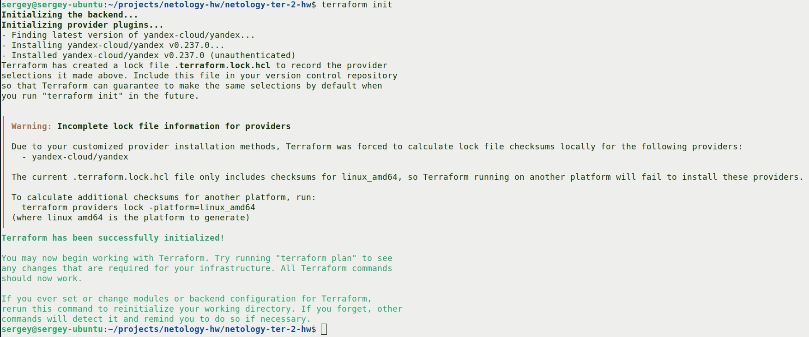
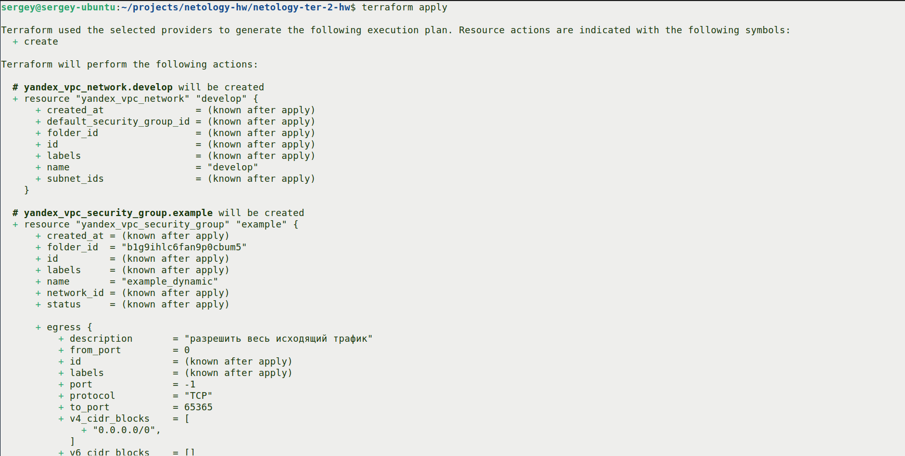
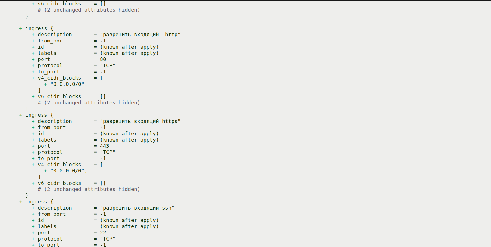
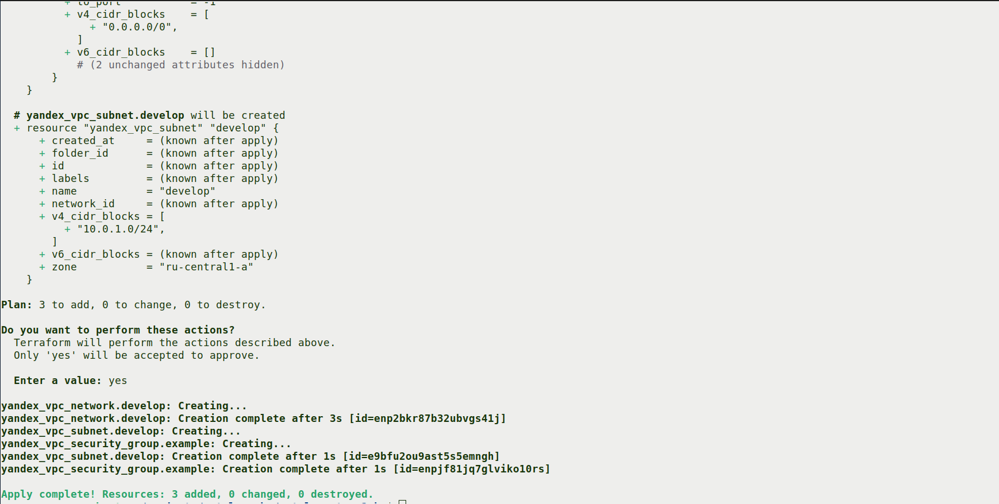

```txt
Apply complete! Resources: 3 added, 0 changed, 0 destroyed.
```

### Группа безопасности в ЛК

Создана группа `example_dynamic` с тремя входящими правилами (TCP 22, 80, 443) и одним исходящим.

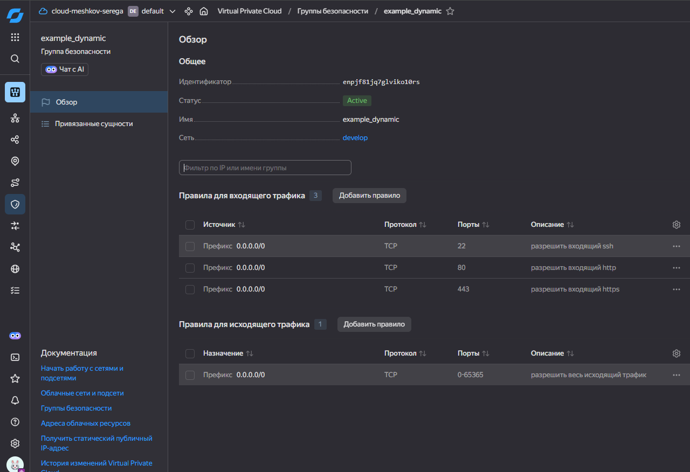

---

## Задание 2. `count`, `for_each` и зависимости между ресурсами

### Файл [`count-vm.tf`](count-vm.tf) — две web-ВМ через `count`

Созданы две одинаковые ВМ `web-1` и `web-2` через `count`. ВМ зависят от db-ВМ (`depends_on = [yandex_compute_instance.db]`).

### Файл [`for_each-vm.tf`](for_each-vm.tf) — main и replica через `for_each`

Созданы две db-ВМ с разными параметрами через `for_each`. Список параметров задаётся в переменной `each_vm`.

### SSH-ключ

В [`locals.tf`](locals.tf) объявлена local-переменная `ssh_key = file(pathexpand("~/.ssh/id_ed25519.pub"))`. Используется для доступа к ВМ.

### План создания

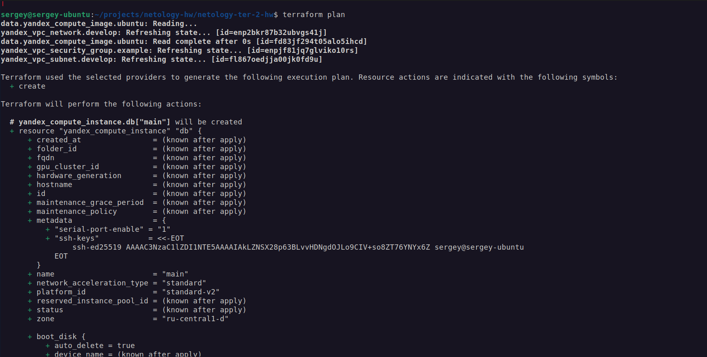
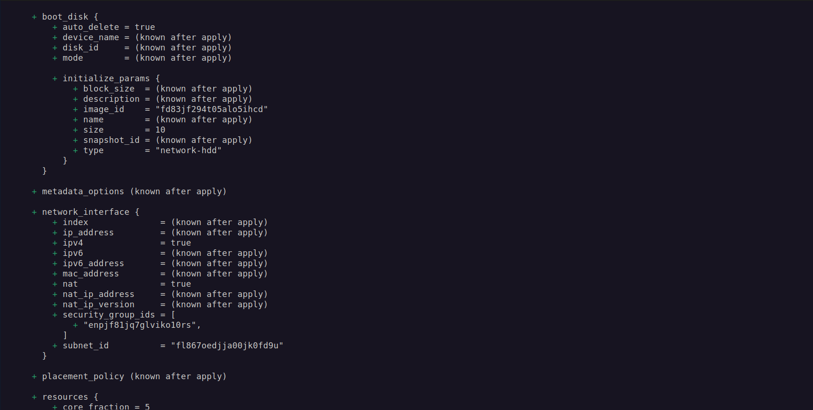

Все параметры (`platform_id`, `cores`, `memory`, `core_fraction`, `preemptible`, `nat`) вынесены в переменные [`variables_vm.tf`](variables_vm.tf). В блоке `metadata` добавлен префикс `ubuntu:`.

---

## Задание 3. Диски через `count` и ВМ с `dynamic secondary_disk`

### Файл [`disk_vm.tf`](disk_vm.tf)

Созданы три одинаковых диска размером 1 ГБ через `count`. Одиночная ВМ `storage` использует блок `dynamic "secondary_disk"` с `for_each` для подключения дисков:

```hcl
dynamic "secondary_disk" {
  for_each = yandex_compute_disk.storage_disk
  content {
    disk_id = secondary_disk.value.id
  }
}
```

### План и применение

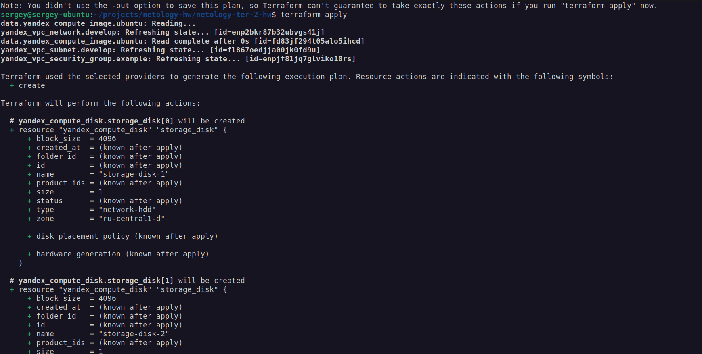
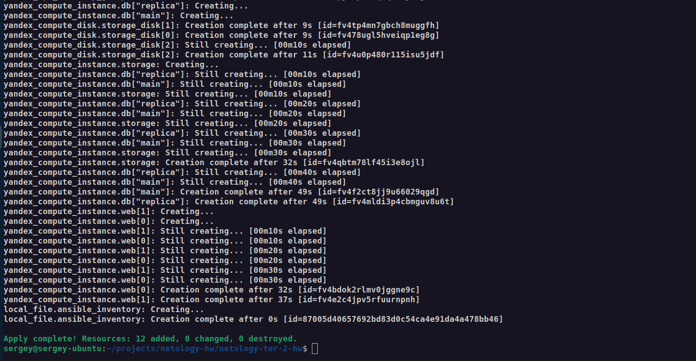

```txt
Apply complete! Resources: 9 added, 0 changed, 0 destroyed.
```

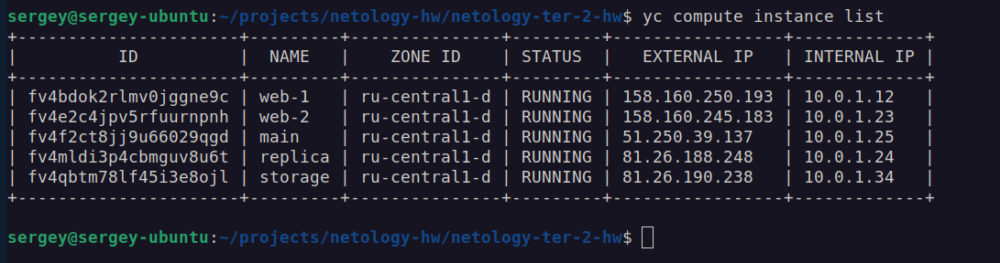

---

## Задание 4. Динамический Ansible inventory через `templatefile`

### Ресурс [`ansible.tf`](ansible.tf)

В `templatefile` передаются сами ресурсы (`yandex_compute_instance.web`, `.db`, `.storage`). Инвентарь работает для любого количества ВМ.

```hcl
resource "local_file" "ansible_inventory" {
  content = templatefile("${path.module}/inventory.tftpl", {
    webservers = yandex_compute_instance.web
    databases  = yandex_compute_instance.db
    storage    = yandex_compute_instance.storage
  })
  filename = "${path.module}/inventory.ini"
}
```

### Шаблон [`inventory.tftpl`](inventory.tftpl)

```text
[webservers]
%{ for vm in webservers ~}
${vm.name} ansible_host=${vm.network_interface[0].nat_ip_address} fqdn=${vm.fqdn}
%{ endfor ~}

[databases]
%{ for name, vm in databases ~}
${vm.name} ansible_host=${vm.network_interface[0].nat_ip_address} fqdn=${vm.fqdn}
%{ endfor ~}

[storage]
${storage.name} ansible_host=${storage.network_interface[0].nat_ip_address} fqdn=${storage.fqdn}
```

### Результат — `inventory.ini`

Файл сгенерирован динамически с 5 ВМ, распределёнными по трём группам:

```txt
[webservers]
web-1 ansible_host=158.160.250.193 fqdn=web-1.ru-central1.internal
web-2 ansible_host=158.160.245.183 fqdn=web-2.ru-central1.internal

[databases]
main ansible_host=51.250.39.137 fqdn=main.ru-central1.internal
replica ansible_host=81.26.188.248 fqdn=replica.ru-central1.internal

[storage]
storage ansible_host=81.26.190.238 fqdn=storage.ru-central1.internal
```

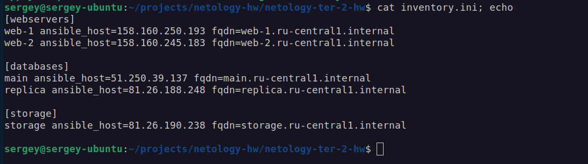

В инвентаре присутствует переменная `fqdn`. Так как в ресурсах ВМ задан `hostname`, FQDN имеет вид `<hostname>.<регион>.internal`.

---

## Разница между `count` и `for_each`

| | `count` | `for_each` |
|---|---|---|
| Что принимает | число | map или set строк |
| Обращение | `resource.name[0]` | `resource.name["key"]` |
| Имена из | `count.index` (0, 1, …) | `each.key`, `each.value` |
| Когда подходит | одинаковые ресурсы | разные ресурсы с разными параметрами |

---

## Автор

- **Студент**: Мешков Сергей
- **Курс**: Netology, DevOps
- **Дата выполнения**: Октябрь 2026
